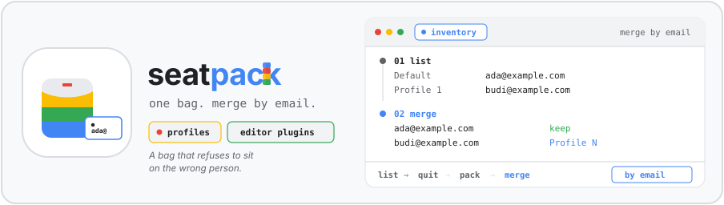
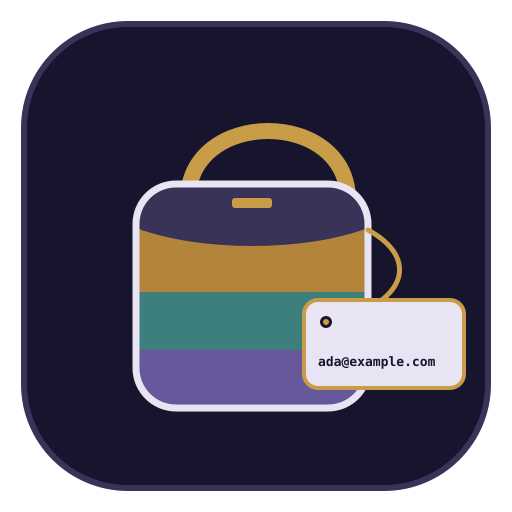

<p align="center">
  
</p>

#  seatpack

*A bag that refuses to sit on the wrong person.*

I copy Chrome profiles, Cursor plugins, VS Code plugins, and Android Studio plugins when I change Macs. Restore merges by email. If that account is already signed in, I leave it in place. Chrome Safe Storage goes in `private/`. I keep `private/` off a public drive.

## Install

```bash
npx skills@latest add pahlevikun/seatpack-chrome-backup
```

## Workflow

Quit Chrome, Cursor, VS Code, and Android Studio before a copy or a restore. A live profile comes back missing files.

Chrome sits behind Full Disk Access. If `Local State` cannot be read, stop and grant access to Terminal. Then run the list again.

1. Inventory. List profiles and plugin sizes. Nothing is copied yet.

```bash
python3 scripts/list.py --home "$HOME" --output /tmp/chrome-plugin-inventory.json
```

2. Pick the buckets you want: `chrome`, `cursor`, `vscode`, `android-studio`.
3. Backup those buckets into a staging folder.

```bash
python3 scripts/backup.py --home "$HOME" \
  --dest "$HOME/Desktop/chrome-plugin-backup-YYYY-MM-DD" \
  --include chrome --include cursor --include vscode --include android-studio
```

4. Zip only if you want one file. The pack script writes ZIP64 and skips `OptGuideOnDeviceModel`. Do not use `ditto`.

```bash
python3 scripts/pack.py "$HOME/Desktop/chrome-plugin-backup-YYYY-MM-DD" \
  --output "$HOME/Desktop/chrome-plugin-backup-YYYY-MM-DD.zip"
```

5. Restore on the next Mac. Double-click `Restore.command`, or run `bash restore.sh`. `Default` there is a different person from `Default` in the backup. An email that is already signed in stays. A missing email is copied as `Profile N`.

The shell scripts in the pack are LF only. macOS ships bash 3.2, and a CRLF `log()` dies with a syntax error.

The names on the banner, Ada Example (`ada@example.com`) and Budi Example (`budi@example.com`), are samples.
